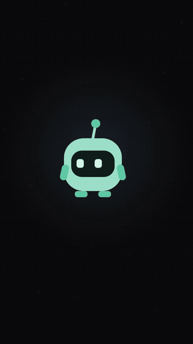

# YO v0.11: a small healthy companion for your PC

A small desktop companion that hangs from the top of your screen in a black pill.
It stays hidden until you call it, or until something you asked for needs you.
It helps you build small daily habits (built on the science of behavior change and anchored on the
five prayers), keeps your tasks, notes and focus sessions, and tells you the prayer times.
It has small daily apps built in (Habits, To-do, Notes, Focus, Prayer times, Translate), opens your apps,
folders and sites, and keeps your reminders, even across restarts. No buttons for things Windows
already does well (media keys, Win+L, clipboard history with Win+V).

  

<b>▶ <a href="docs/yo-demo.mp4">Watch the full video, with sound (42 s)</a></b>

## Install it (Windows 10/11)

Run `YO-Setup-<version>.exe` from the latest release. It installs for you only (no admin rights), adds YO
to the Start menu and starts it. The first time, a welcome card shows the few things worth knowing.

After that, YO updates itself: it checks its GitHub releases a little after it starts and every few hours,
downloads a new version quietly, and comes down with "Update ready": Restart now, or Later (it installs
the next time YO closes). Tray menu > Check for updates asks right away.

Windows may say "Windows protected your PC", because the installer isn't signed yet (a code-signing
certificate costs money every year). Click *More info*, then *Run anyway*.

Uninstall from Settings > Apps like any app. Your looks and settings in %APPDATA%\YO are kept, in
case you install YO again; delete that folder to remove them too.

### The tray menu (right-click YO's icon, bottom right)

- Open YO
- Start with Windows: YO starts quietly in the tray when you log in.
- Shortcut: Ctrl+Space, Ctrl+Shift+Space, Ctrl+Alt+Y or Alt+Shift+Y. If another app already uses
  the one you pick, YO takes the next free one and tells you.
- Sounds on or off
- About YO, backup and privacy
- Check for updates
- Quit

## Run it from the code

1. Install Node.js LTS from https://nodejs.org
2. In this folder:

       npm install
       npm start

## Make the installer

       npm run icons    (only after changing YO's look: redraws build/icon.png and the tray icons)
       npm run dist     (writes dist/YO-Setup-<version>.exe, its .blockmap and latest.yml)

If the build stops with EBUSY on an .asar file, something is holding files in dist/; build elsewhere:

       npx electron-builder --win nsis --publish never -c.directories.output=%TEMP%\yo-build

Release checklist:

1. Bump "version" in package.json and the title of this README.
2. `npm test` passes.
3. `npm run dist`, then install the new exe on a normal (non-admin) account.
4. Try: the shortcut, every tile of the home panel, a reminder in 1 min,
   Translate (online), Customize, Start with Windows (sign out and in), the tray menu.
5. Uninstall: YO is gone from the Start menu and from Startup apps.
6. Commit, tag (`git tag v<version>`), push, and make a GitHub release (not a draft, not a pre-release)
   with all three files: `YO-Setup-<version>.exe`, `YO-Setup-<version>.exe.blockmap` and `latest.yml`.
   Installed copies of YO find it there and update themselves.

## How it behaves

1. Call it with `Ctrl+Space` (fallback `Ctrl+Alt+Y`). The black pill slides down from the top
   edge and the robot drops in.
2. Click the robot, or just start typing. Matching actions appear under the bar as you type.
   `↑` `↓` pick, `Enter` runs. Actions that need more ("open …", "remind me in …") fill the bar first.
   The grid button (or `↓` / `Enter` on an empty bar) opens the home panel: tiles for Translate,
   Habits, To-do, Notes, Focus, Prayer, Inbox and Customize,
   and a row of YO's moves. Arrow keys move over the tiles, `Enter` opens one.
3. `Esc` closes. If you do nothing, YO leaves after 7 seconds.
4. `↑` in an empty bar brings back what you ran before. The actions you use most come first, and the
   panel starts with a Recent row (right-click a chip there to pin it).

Reminders, timers and unlocks also go to the inbox: a small dot on YO means something new.
Type `inbox` to see the last ones.

When something needs you (a reminder, an approval), YO comes back alone and says it inside the pill.
Click it, or press the shortcut, to open the card. If you're busy typing, it waits until you're done.

## What it does

- Open: `open spotify` finds the app among those installed (normal and Store apps; `vsc` works too),
  `open downloads` / `documents` / `desktop`..., `open github.com`, or `open C:\some\folder`.
  Typing `open spo` already suggests Spotify by name.
- Time: `remind me in 20 min to stretch`, `timer 25 min`. Saved to disk: they survive a restart,
  and one that came due while YO was closed is delivered when it starts, marked as missed.

Safety: the page never runs anything itself. It asks the main process, which checks every request
again. Opening a program or script file (.exe, .bat, .ps1...) always asks first. Sites open only as http/https.

### Mini apps

The home panel has the app tiles. Each one opens inside the pill, with YO in the
corner, `← All apps` to go back and `Esc` to close. You can also type their name; what you type after
it fills the app in.

- Translate: `tr hola to english`, `translate bonjour`. Pick languages from chips (From can detect the language); `⇄` swaps.
  `Ctrl+Enter` copies. The text is sent to MyMemory (a free translation service, no account) and
  needs internet; nothing else is sent.
- Habits: small daily habits built on the four laws of behavior change (make it obvious, attractive,
  easy, satisfying). Add one as a sentence: `After Fajr I will read 2 pages because I'm a reader`.
  YO reads the cue (after or before a prayer, a clock time, or a moment like "with my coffee"), the
  habit, its tiny version and who you're becoming. The day is drawn as a path between the five prayers
  (your real prayer times from the Prayer app), each habit where its cue is, YO standing at now.
  At a habit's cue YO comes down once, quietly (never while you focus): Done, Just the tiny version,
  Not today. The tiny version counts. Each row shows the last 7 days; one miss is fine, never miss
  twice (an orange ring warns, two in a row offers to make it smaller). Month shows a habit's days,
  its best run and whether you ever missed twice. Packs to start in one tap: Bac and exams, Ramadan,
  Summer water, Healthy body. A 7-day run unlocks a sprout on YO's antenna. Kept on this PC.
- Calculator: no tile any more, but typing math in the bar still answers (`84 + 20%`, `20% of 150`,
  `5 km in miles`), and `calc` opens the calculator with its history.
- Notes: a scratchpad that saves itself. The first line is the title; pin, search, delete (it asks
  once). `note call the dentist` from the bar makes a note; Ctrl+N makes a new one.

- To-do: type tasks in plain words, from the app or straight from the bar:
  `todo math homework friday 18:00 #math`, `todo call mom tomorrow`, `exam physics 12/11`.
  It understands today, tonight, tomorrow, weekdays, next week, in 3 days, 12/11 (day/month), 12 nov,
  18:00, 18h, 6pm, #subjects and `!` for important, and shows what it understood as you type.
  Repeating tasks: `gym every mon wed 18:00`, `revise every day`, `lab every weekday`; ticking one
  puts the next one on the list (unticking takes it back).
  Today (late, today, and tasks with no date), Upcoming, Done (kept a month). Exams in the next 30 days
  show as a countdown on top. A task with a time brings YO back at that time (even when hidden), and
  an exam the evening before; the card has a Mark done button. Saved in tasks.json.

- Focus: Pomodoro with YO. A ring counts down while a big YO focuses with you (headphones on, calm
  eyes) and cheers you on ("You got this!", "Halfway there!", "Last 5 minutes!"); on breaks it holds its
  mug. Rounds of focus and short breaks, then a long break; lengths and rounds in its settings.
  Pick a task from your To-do to focus on (or type `focus on math homework`; `focus 50` starts 50 min).
  Optional focus sound made in code: rain or a deep calm noise, with a little waveform.
  The timer keeps going when you close it: the tray tooltip shows the time left, and YO comes back with
  "Focus complete!" (Start break, Mark done). While you focus, YO keeps unlock news for the break.
  Space starts or pauses. A daily goal of sessions (default 4) shows as dots and YO cheers when you
  reach it; Week shows your focus minutes per day, with the goal as a dashed line.

- Prayer: the day's prayer times for your city, worked out on this PC (no internet, nothing sent),
  checked against published Tunisia-method tables to within a minute. Pick your city the first time
  (Tunisian cities, major cities worldwide, or coordinates); each city keeps its own clock.
  Methods: Tunisia (default), Muslim World League, Umm al-Qura, Egypt, Morocco, Algeria, France,
  Turkey, ISNA, Karachi, Gulf, Dubai; Asr standard or Hanafi; ±minutes per prayer to match your mosque.
  A calm scene follows the real sky (night, dawn, day, sunset) with YO on a prayer rug holding its lantern.
  A bell per prayer, an optional heads-up before (default 10 min). At prayer time YO comes down
  quietly with a soft tone and its crescent face: I prayed ✓, Snooze 10 min. Then it keeps its own news
  to itself for a while (15 min). What you mark as prayed stays on this PC; no streaks, no scores.
  The Prayer tile shows the next prayer. In Ramadan the countdown is to Suhoor and Iftar.

Dropping text on YO while Translate, the Calculator or Notes is open puts it in there.

YO does the work, not just sits next to it. Its visor becomes a little screen for each tool, and it
flips like a screen when it changes:

- In the panel, pointing at a tile shows the tool on YO (speech marks, `=`, clock eyes, `↗ ↗`...)
  and the bar shows how to type it (`tr hola to english`, `timer 25 min`...).
- Clicking a tile grows it into the app; `← All apps` shrinks the app back into its tile.
- Translate: YO talks while it works, then flashes a letter of the new language (É, Я, あ, ع...).
  `⇄` makes it backflip; offline, it covers its eyes.
- Calculator: the answer shows on YO's visor as you type. Dividing by zero makes it dizzy.
- A timer winds a ring around YO's antenna; a reminder goes into its little notebook; opening an app
  flashes `↗ ↗`; the inbox shows `! !`.

### Drop things on YO

Drag a file or some text onto YO: its whole visor becomes a big open mouth ("gimme!"), then it
snaps shut, chews, and licks its lips.

- A file: copy its path, show it in its folder, or open it (programs still ask first).
- Text: turn it into a reminder ("remind me in 10 min to ..."), or copy it. A link: open it.

### Quick answers

Type and the answer shows up as the first row; `Enter` copies it (the Calculator app does math with
a history).

- Math: `12*7`, `= sqrt(16) + 2`, `2^10`, `20% of 150` (worked out by YO's own parser; nothing you type is run as code)
- Units: `5 km in miles`, `100 f to c`, `3 kg in lb`, `1 gb in mb`, `60 mph in km/h`
- Colors: `#ff6600` or `rgb(255, 102, 0)` gives hex, RGB and HSL with a preview
- `uuid`, `timestamp`, `timestamp 1700000000`, `base64 hello`, `unbase64 aGVsbG8=`

One color runs through the whole pill: YO's own (the one you pick in Customize). The panel's icons
are drawn in one ink and made of YO's parts (its eyes, visor, antenna, party hat); only those small
details take YO's color, and they blink or bob when you point at a tile.

## YO itself

YO is drawn and moved in code (`renderer/mascot.js`); nothing is an image file.

- It has springs: it squashes when it lands, its antenna wobbles, and its ears, bells and hats lag behind.
- It has little arms: it waves hello, cheers on success, raises a hand to ask, covers its eyes on errors.
- Its eyes blink, follow your pointer and look at what you type. There are 9 eye shapes
  (happy, wide, squint, sleepy, heart, star, dizzy and more).
- Particles: sparks, hearts, music notes, z's, a sweat drop.
- Hold YO to pet it. Boop its antenna three times and it gets dizzy.
- Leave the bar open and untouched for 20 seconds and YO dozes off. Move or type to wake it.
- The first time it shows up each day it says a proper hello.
- While it waits it lives a little: it yawns, stretches, looks around, hums, winks, or reads a tiny book.
- Emotes: type `dance`, `jump`, `hi yo`, `flip`, `spin` or `love you` (also YO's moves in the panel).
- Seasonal outfits, automatic by date: Ramadan lantern, Eid and New Year party hat, Halloween
  witch hat, winter beanie, summer sunglasses. They only fill what you left empty.

### Music

While YO is on screen it knows what's playing (Spotify, YouTube in the browser, any app that shows
up in Windows' media controls). It bops along and shows the song when it peeks out. It only asks Windows
while YO is visible and keeps nothing.

### Unlockables

Some looks are earned by using YO; you get one small "New!" moment, never a nag.

| Unlock | How |
|---|---|
| Propeller hat | Run 50 actions |
| Halo | Pet YO 10 times |
| Nightcap | Use YO after midnight |
| Grad cap | Copy 20 quick answers |
| Gold color | Use YO on 7 different days |
| Sprout (antenna tip) | Keep any habit 7 days in a row |
| Water bottle | Summer water pack: a habit 7 days in a row |
| Sweatband | Healthy body pack: a habit 7 days in a row |
| Backpack | Bac and exams pack: a habit 7 days in a row |
| Golden fanous | Ramadan pack: a habit every day of the month |

Free for everyone, with a Tunisian touch: the chechia, a jasmine tip (it also comes by itself in
summer), the fouta scarf, YO in Sidi Bou Said white and blue, and the Sidi Bou Said pill (a white pill
with blue accents). Ticking a habit gets its own little celebration: YO sips water, jogs out and back,
or reads a few pages.

Locked items show a lock in Customize; click one to see how far you are.

### Customize YO (right-click the robot)

A live preview on the left, choices on the right. Everything saves as you click:

- Body: 8 colors (and gold, to earn); eyes classic, round or pixel in 5 colors; antenna tip
  (ball, heart, star, bolt, flower); a sticker (freckles, stripes, bolt, heart).
- Outfit: hat (beanie, party, witch, crown, cap, headphones, bow, plus the ones to earn); neck
  (scarf with a swinging tail, bow tie, a cape that flutters); glasses (sunglasses, round);
  holding (lantern, coffee mug, game controller); seasonal outfits.
- Pill: style (dark, smoke, tinted with YO's color, light), position (left, center, right), size.
- Sound: voice and volume.
- Saved: three outfit slots, and a look code (like `YO-3RF`) to share your YO with friends:
  paste one to wear it (anything you haven't unlocked yet falls back to the default).
- Seasonal outfits on or off, with what's on today and what comes next.
- Voice: Robot, Soft or Retro (8-bit), or Off; volume low, mid or high.
- "Surprise me" picks a random look; Reset goes back to the start.

Sounds are made in code too (`renderer/sound.js`): 21 sounds, each with variants and a small random
pitch change so they never repeat exactly. They play on key moments (arriving, opening, success,
reminders, approvals, petting, waking up...) and never on every keypress. The tray has a Sounds switch.

## Other things

- English only for now (French and Arabic strings are kept in `i18n.js` for later).
- Quit with `/quit` in the bar or from the tray menu.
- Hidden, YO uses almost nothing: about 0.2% of one CPU core (no animation runs while it's hidden)
  and about 150 MB of memory.
- The mic button only shows the listening look for 3 seconds. Real voice comes later.
- A popup never steals focus from the app you are typing in.
- "Reduce motion" in Windows replaces the animations with short fades.

## Your data, licence and privacy

- **About YO** (tray menu, or type `about`, `backup`, `privacy`): the version, the licence, the credits,
  and your data.
- **Back up** everything in one `.yo` file: habits, tasks, notes, reminders, Focus history, prayer
  settings, looks and settings. **Restore** shows what's inside first, saves what you have now aside,
  then restarts YO with the backup. A **weekly backup** goes to `Documents\YO backups` by itself (the
  last 4 are kept; it can be turned off). **Delete all my data** wipes YO's data from this PC (backups stay).
- **Licence:** freeware. Free to use, not open source: no copying, changing, reselling or republishing.
  See [LICENSE](LICENSE). Electron and Chromium keep their own open-source licences.
- **Privacy:** no account, no cloud, no tracking. Only the text you translate leaves your PC (to
  MyMemory). See [PRIVACY.md](PRIVACY.md).

## Files

    main.js            hidden window, transparent, always on top, click-through
    main/              agent.js (YO's hands: checks, approvals, actions, reminders),
                       apps.js (installed apps), store.js (JSON files), watch.js (what's playing),
                       backup.js (backup, restore, the weekly backup, delete my data),
                       updater.js (updates from the GitHub releases),
                       translate.js (asks MyMemory), todo.js (tasks, dates, due alerts)
    preload.js         the only bridge to Electron (no Node in the page)
    renderer/          index.html, style.css, i18n.js, app.js,
                       mascot.js (YO's body and motion), sound.js (its voice),
                       commands.js (the action list), quick.js (quick answers), unlocks.js,
                       agent.js (asks the main process), mock-agent.js (demo, for a plain browser),
                       miniapps.js (what every mini app shares), apps/ (habits, todo, notes, focus, prayer, translate, calc, about),
                       prayer-calc.js (prayer times from the sun's position)
    scripts/           make-icons.js (draws the icons from the real YO)
    build/             icon.png and installer.nsh (installer settings)
    tests/             npm test (nothing real happens: Electron, keys, launching and the network are faked)

YO keeps its files in %APPDATA%\YO: settings.json (what you allowed "Always"), reminders.json,
apps.json (the installed apps it found), tasks.json (your to-do list). Your look and sound choices are in the same folder.

## Next

- Habits: a Ramadan mode that moves habits around Suhoor and Iftar by itself.
- French, then Arabic.
- Code signing, so Windows stops showing "Windows protected your PC".

